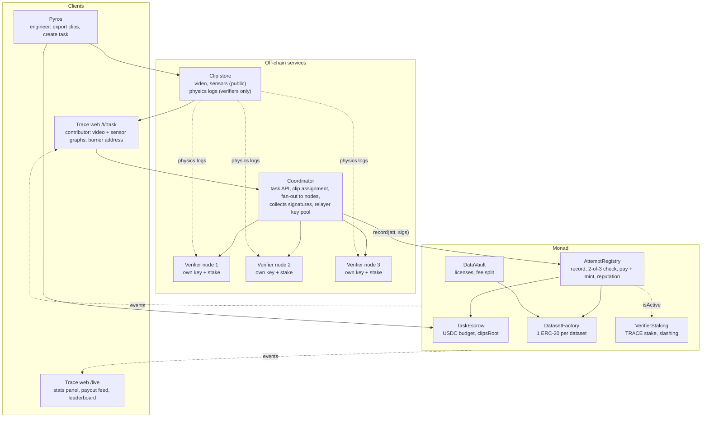
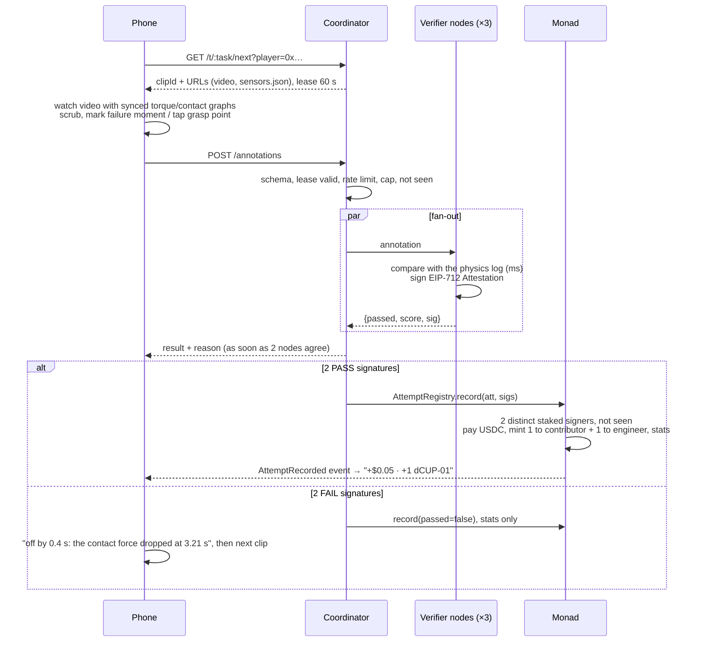

# Trace architecture

Trace is a tokenized data economy on Monad. The first market is a decentralised data-labelling network for physical AI. Contributors annotate robot recordings (video plus sensor streams) on their phones. Three independent [Pyros](https://github.com/RudranshG07/pyros) verifier nodes check each annotation against the recording's exact physics log, and two of them must agree. Monad then records the annotation, pays the contributor in USDC and mints dataset tokens in a single transaction. Demonstrations (controlling an arm in a browser sim) are a bonus mode that uses the same pipeline.

This document is the build spec for the hackathon (4 Nov 2026) and the base for what comes after. Facts marked **(verify)** are not confirmed yet. Check them on the day and record the answers in `docs/resolved.md`.

## Principles

1. **Physics is the reviewer.** Pyros keeps an exact log of every sim recording: contact times, torques and object poses. An annotation passes when it matches the log. There is no voting and no manual review.
2. **The answer never reaches the client.** The browser gets video and sensor graphs. The physics log stays on the verifier nodes, and only its hash is on chain.
3. **Three nodes, two signatures.** Each verifier node has its own key and its own TRACE stake. A result is valid on chain only with 2 of 3 signatures.
4. **One verified contribution is one payable unit.** One annotation leads to one transaction: record, pay, mint.
5. **The chain stores proofs, not data.** Video, sensor streams and labels live off chain. Monad stores hashes, money, tokens and reputation.
6. **Per-contributor and per-contribution storage.** Avoid global counters so that different contributors' payouts can run in parallel.
7. **Contributors never touch gas or wallets.** They get a burner address on first load, and a relayer pays all gas.

## Why pay people for answers Pyros already knows?

Judges will ask this, so the answer is part of the design:

- **Sim clips are the verifiable ground.** Physics gives an exact answer, so a stranger's label can be scored with no trust. That's why the network can open to anyone from day one.
- **Real-robot recordings are the product.** A real ROS 2 log has no perfect physics log. Real clips are mixed with hidden sim "gold" clips that look the same, and each contributor's real-clip labels are weighted by their score on gold clips plus 2-of-3 agreement between contributors. A contributor who answers sim clips correctly has earned trust on real ones.
- **The demo runs entirely on sim clips**, because that's the part where physics proves the loop works. Real-robot ingestion is on the roadmap.

## System



### Where each piece runs

| Piece | Runs on | Today | Later |
|---|---|---|---|
| Clip exporter | Engineer's machine (Pyros) | A Python script exports 20–30 MuJoCo sim clips ahead of time. | A "Trace task" panel in the Pyros IDE, plus ingestion of ROS 2 recordings. |
| Coordinator and relayer | Always-on server | Laptop plus a cloudflared or ngrok tunnel, with a pool of N relayer keys. | Cloud VM. Any coordinator can relay, because the chain checks the verifier signatures. |
| Verifier nodes | Separate processes, each with its own key | 3 processes on the laptop, on ports 8101–8103. | Independent operators, each staking TRACE. |
| Web (`/t/:task`, `/live`, `/demo`) | Static hosting | Vercel or GitHub Pages. | Same. |
| Clip store | Server disk or bucket | Public files (video, sensors) served statically. Physics logs live only on each verifier's disk. | IPFS or object storage for the public parts. Physics logs are revealed after the task closes so anyone can audit. |
| Contracts | Monad | Monad testnet with test USDC. | Mainnet after legal review. |

## Core flows

### 1. Create a task

1. Pyros exports clip bundles (see the clip bundle format below).
2. The engineer picks the annotation type, for example "mark the moment the grasp failed", and sets the pay per annotation, the budget and the per-contributor cap.
3. `TaskEscrow.createTask()` pulls the USDC and stores:
   - `clipsRoot`: the Merkle root over `(clipId, keccak256(physics_log))` for every clip. This commits the task to its answers before anyone plays.
   - `rulesHash`, the pay, the per-contributor cap and the deadline.
4. `DatasetFactory` deploys the task's dataset token.
5. The coordinator publishes `/t/<taskId>` and a QR code.

For the demo, a deploy script creates one task, `grasp-slip-01`, from the exported clips.

### 2. Annotate and verify



- **Leases** stop one contributor from loading many clips at once and farming them in parallel. Many different contributors can annotate the same clip.
- **The result reaches the phone before the chain confirms.** The phone then waits for `AttemptRecorded`, and that wait is the "tap to paid" time shown on `/live`.

### 3. Demonstrate (bonus)

The flow is the same, except the contribution is a move file from the `/demo` browser sim (MuJoCo WASM). The verifier nodes **replay** the move file headless instead of looking up a log. This is slower (seconds, not milliseconds), but the attestation, contract call and payout are identical. A demonstration that passes or fails is saved as a new clip that others can annotate. The demonstration details are in the appendix.

### 4. License and earn

1. A buyer calls `DataVault.license(dataset)` and pays the dataset's license price in USDC.
2. The vault sends the USDC to the dataset token and calls `distribute(amount)`, which raises a per-share accumulator. This costs O(1) gas no matter how many holders there are.
3. Each holder calls `claim()` whenever they like. Corrections on mint and transfer (the standard "dividend-paying token" pattern) keep the tokens freely tradable.
4. The data server checks `DataVault.isLicensed(dataset, buyer)` before serving the labels and clips.

**Demo finale:** a "robotics lab" wallet licenses `dCUP-01` for $5, and one transaction splits it across everyone in the room.

### 5. Disputes (roadmap)

After a task closes, the physics logs are published. Anyone can check a log against `clipsRoot` and re-run any verdict. Within the dispute window, a challenger who shows that a node signed a wrong result gets that node's TRACE stake slashed and receives a reward. Today the owner holds `slash()`, and the trust model below says so.

## Data contracts

Freeze these five interfaces first so that the workstreams can build in parallel.

### Clip bundle (Pyros exporter → store)

```
clips/grasp-slip-01/<clipId>/
  video.mp4        public    720p or lower, H.264, 10–20 s, 30 fps
  sensors.json     public    the time series the contributor sees
  thumb.jpg        public
  physics.json     PRIVATE   ground truth, copied only to the verifier nodes
```

`sensors.json` (public):

```json
{
  "schema_version": "1.0",
  "clip_id": "c07",
  "fps": 30,
  "duration_s": 12.0,
  "rate_hz": 50,
  "series": {
    "gripper_contact_force_n": [0.0, 0.0, 4.1],
    "joint_torque_nm": { "j1": [], "j2": [], "j3": [] }
  }
}
```

`physics.json` (private):

```json
{
  "schema_version": "1.0",
  "clip_id": "c07",
  "events": [
    { "type": "contact_lost", "t": 3.214, "body": "cup" },
    { "type": "collision", "t": 7.020, "geoms": ["gripper", "table"] }
  ],
  "primary_event": { "type": "contact_lost", "t": 3.214 },
  "grasp": { "frame_t": 1.0, "valid_zone": [[0.40, 0.28], [0.47, 0.28], [0.47, 0.36], [0.40, 0.36]] },
  "objects": [{ "name": "cup", "frame_t": 1.0, "box": [0.38, 0.25, 0.12, 0.18] }]
}
```

- The exporter generates **failing grasps on purpose**. It runs scripted pick-ups with randomized friction, grip force and payload, so the cup slips at a different time in each clip, and some clips succeed and act as controls. It reads `contact_lost` from `data.contact` and renders the video with the MuJoCo offscreen renderer.
- `valid_zone` comes from Pyros: it simulates grasps on a grid of image points ahead of time and keeps the points where the hold is stable within torque limits. All coordinates are fractions of the frame, with the origin at the top left.

### Rules (per task)

```json
{
  "schema_version": "1.0",
  "task": "grasp-slip-01",
  "annotation": "failure_moment",
  "failure_moment": { "tolerance_s": 0.15, "require_type": true },
  "grasp_point": { "enabled": false },
  "min_dwell_ms": 3000,
  "lease_s": 60
}
```

`min_dwell_ms` rejects annotations submitted faster than a person could have watched the clip.

### Annotation (phone → coordinator)

```json
{
  "schema_version": "1.0",
  "task_id": "0x…32 bytes",
  "clip_id": "c07",
  "player": "0x…20 bytes",
  "lease_id": "…",
  "kind": "annotation",
  "failure_moment": { "t": 3.25, "type": "contact_lost" },
  "grasp_point": null,
  "dwell_ms": 9400,
  "client": "web-0.1.0"
}
```

`contentHash = keccak256(raw request body bytes)`. The coordinator and the nodes store those exact bytes.

### Coordinator API

| Method | Path | Returns |
|---|---|---|
| `GET` | `/t/:taskId` | Task info, pay, remaining budget and the contributor's remaining cap. |
| `GET` | `/t/:taskId/next?player=` | `{ clipId, videoUrl, sensorsUrl, leaseId, expiresAt }` |
| `POST` | `/annotations` | `{ attemptId, passed, score, reason, status: "submitted" }` |
| `GET` | `/attempts/:attemptId` | `{ status: "pending" \| "confirmed" \| "failed", txHash, confirmMs }` |
| `GET` | `/stats` | Median and p95 of sign time and submit-to-receipt time, plus queue depth. |

Verifier node API (internal): `POST /verify` takes the annotation and returns `{ passed, score, reason, signature, signer }`.

### Attestation (EIP-712, signed by each node)

```solidity
struct Attestation {
  bytes32 taskId;
  bytes32 itemId;       // keccak256(clipId) for annotations; contentHash for demonstrations
  address contributor;
  bytes32 contentHash;  // keccak256 of the submitted bytes
  uint8   kind;         // 0 = annotation, 1 = demonstration
  bool    passed;
  uint16  score;        // 0–10000
  uint64  deadline;     // signature expiry
}
// domain: name "Trace", version "1", chainId, verifyingContract = AttemptRegistry
```

`attemptId = keccak256(abi.encode(taskId, itemId, contributor))`. As a result, **each contributor is paid at most once per clip**, however many annotations they send, and the same attestation can't be paid twice.

The node's result must not depend on its clock or on random values, so that all three nodes sign the same bytes. The coordinator chooses `deadline` and sends it to every node.

## Verification

### Annotations (core): a lookup, taking milliseconds

| Annotation | Check against `physics.json` | Catches |
|---|---|---|
| Failure moment | `\|t − primary_event.t\| ≤ tolerance_s` (0.15 s), and the type matches | Guessing, random clicks |
| Contact or collision event | The event exists in `events` at that time, and the contact force supports it | Wrong event type |
| Grasp point | The point is inside `grasp.valid_zone` (precomputed by simulating grasps in Pyros) | Points that wouldn't work |
| Object box | IoU with the true box is at least the threshold (sim). Real clips use hidden gold clips plus 2-of-3 agreement between contributors. | Sloppy or fake labels |

Score: `10000 × (1 − |dt| / tolerance)` for a failure moment, and the distance from the zone centre for a grasp point. The score is stored on chain and becomes the label's quality weight in the dataset.

A failure reason must teach the contributor something: `"you marked 3.71 s; the cup lost contact at 3.21 s (watch the contact-force line drop)"`.

**Today, only failure moment is required, with grasp point added if time allows.** Contact events and object boxes are roadmap.

### Making the three nodes independent

- Each node is a separate process with its own key, its own copy of the physics logs (whose hashes are checked against `clipsRoot` at startup) and its own TRACE stake.
- The code is the same today. Later, nodes run by different operators, ideally with independent implementations.
- The coordinator submits as soon as two nodes agree. A node that disagrees with the majority is logged. That's the seed of the slashing story.

### Anti-abuse

- Leases: one active clip per contributor.
- `min_dwell_ms`: no instant answers.
- A per-contributor cap per task, enforced on chain.
- Rate limits per address and IP at the coordinator.
- One payment per (clip, contributor), enforced on chain.
- **Known gap:** a script could read `sensors.json` and find where the force drops. That's acceptable for a sim demo. In production, real clips can't be auto-solved this way, and hidden gold clips are what score contributors.

## Contracts (Foundry, Solidity)

These are interface sketches. The final code may merge contracts if time runs short, but the external behaviour should stay the same.

```solidity
// TaskEscrow
struct Task {
  address engineer;
  address dataset;
  uint128 payPerItem;          // USDC, 6 decimals
  uint128 remaining;
  uint128 verifierFee;         // per paid item, split across signers; can be 0 today
  uint32  maxPaidPerContributor;
  uint8   quorum;              // 2
  uint64  deadline;
  bytes32 clipsRoot;           // Merkle root over (clipId, keccak256(physics_log))
  bytes32 rulesHash;
}
function createTask(bytes32 salt, TaskParams calldata p) external returns (bytes32 taskId); // taskId = keccak256(engineer, salt)
function payout(bytes32 taskId, address to, address[] calldata signers) external;          // onlyRegistry
function refund(bytes32 taskId) external;                                                 // engineer, after deadline
event TaskCreated(bytes32 indexed taskId, address indexed engineer, address dataset, uint256 budget, uint256 payPerItem, bytes32 clipsRoot);

// AttemptRegistry
struct Stats { uint32 submitted; uint32 passed; uint64 lastAt; }
mapping(bytes32 => bool)                       public seen;       // attemptId
mapping(address => Stats)                      public stats;      // reputation
mapping(bytes32 => mapping(address => uint32)) public paidCount;  // taskId → contributor
function record(Attestation calldata a, bytes[] calldata sigs) external; // permissionless
//   requires: block.timestamp <= deadline; !seen[attemptId];
//   recovered signers strictly ascending (distinct), each VerifierStaking.isActive, count >= task.quorum
//   if passed && paidCount < cap: escrow.payout + dataset.mint(contributor, 1e18) + dataset.mint(engineer, 1e18)
event AttemptRecorded(bytes32 indexed attemptId, bytes32 indexed taskId, address indexed contributor,
                      bytes32 itemId, uint8 kind, bool passed, uint16 score, bytes32 contentHash, uint256 paid);

// DatasetFactory → DatasetToken (ERC-20 + dividend accumulator)
function createDataset(bytes32 taskId, string name, string symbol) external returns (address); // onlyEscrow
function mint(address to, uint256 amount) external;   // onlyRegistry
function distribute(uint256 usdcAmount) external;     // onlyVault, O(1)
function claim() external;
function claimable(address) external view returns (uint256);

// DataVault
function setLicensePrice(address dataset, uint256 price) external; // engineer
function license(address dataset) external;
function isLicensed(address dataset, address who) external view returns (bool);
event Licensed(address indexed dataset, address indexed buyer, uint256 amount);

// VerifierStaking + TraceToken
function stake(uint256 amount) external;
function isActive(address verifier) external view returns (bool); // stake >= minStake
function slash(address verifier, uint256 amount, address to) external; // onlyOwner today; challenge game later
```

- **Token amounts:** each verified contribution mints `1e18` to the contributor and `1e18` to the engineer, so the total supply is 2 × the number of verified contributions. The idea doc says supply "equals" that number, which counts only the contributor side. Engineers own half of every dataset they fund.
- **Fees:** take the platform fee (e.g. 10%) when the task is created. The verifier fee for each paid item is split across the signers, so running a node earns money. Both can be zero for the demo.
- **Failed attestations go on chain too**, because reputation needs the pass rate. They make no USDC transfer and no mint.

## Parallel execution: what actually parallelizes

Monad executes transactions optimistically in parallel and re-executes any that conflict, so a conflict never affects correctness, only throughput. Each `record()` writes:

| Slot | Scope | Contention |
|---|---|---|
| `seen[attemptId]` | Per contribution | None |
| `stats[contributor]`, `paidCount[task][contributor]` | Per contributor | None across contributors |
| Contributor's dataset-token balance and dividend correction | Per contributor | None across contributors |
| Engineer's dataset-token balance | Per task | **Hot within one task** |
| `Task.remaining`, dataset `totalSupply` | Per task | **Hot within one task** |
| USDC `balanceOf[TaskEscrow]` | Global to the escrow | **Hot across tasks** |

To say this honestly in the pitch: contributors' payouts don't touch each other's state, and the hot slots are a few per-task counters. To push further after the event:

- **Lazy engineer mint:** accrue the engineer's share as `2 × verifiedCount` and let the engineer mint it on claim.
- **Per-contributor budget lanes.**
- **One escrow clone per task.**

**Relayer nonces are the real bottleneck.** One EOA's transactions have to go in nonce order. Use a pool of N relayer keys (start with 5), assign attempts round-robin, track nonces locally and fund every key. Because `record()` is permissionless and checks only the verifier signatures, any key can relay.

## Monad specifics (all verify)

| Item | Value or note |
|---|---|
| Testnet chain ID | `10143` (verify) |
| RPC | `https://testnet-rpc.monad.xyz` (verify). Get a second RPC as a fallback. |
| Explorer | `https://testnet.monadexplorer.com` (verify), used for payout-feed links. |
| USDC | **Don't hardcode a guessed address.** If official test USDC with a faucet is confirmed, use it. Otherwise deploy `MockUSDC` (6 decimals) and label it "test USDC" on screen. |
| Gas accounting | Monad charges on the **gas limit**, not gas used (verify). Measure each function's gas once and set a tight explicit `gasLimit` per call. |
| Finality | Sub-second (verify). The panel shows measured numbers only, never quoted ones. |

## Live stats panel (`/live`)

Everything is read from the chain or measured. Nothing is hardcoded.

| Metric | Source |
|---|---|
| Total transactions and transactions per second | `AttemptRecorded` and `Licensed` logs per block, over a sliding 10 s window. Show network-wide TPS next to it. |
| Tap-to-paid time | The phone measures submit to `AttemptRecorded`, and the coordinator reports sign time and submit-to-receipt time via `/stats`. Show the median and p95. |
| Verifier agreement | Per node: signatures given and disagreements with the majority. This shows the 2-of-3 working. |
| Gas spent | Sum of `gasUsed × price` from receipts, plus the cost per paid annotation. |
| USDC paid and tokens minted | Sum of `paid`, and the dataset token's `totalSupply`. |
| Payout feed | The latest `AttemptRecorded` events, each linking to the explorer. |
| Leaderboard | `stats[contributor].passed`. Show short addresses or a nickname kept in localStorage. |
| Dataset token price | The DEX pool's spot price, if a pool exists. |

## Trust model

v1 uses **3 staked verifier nodes with a 2-of-3 quorum on chain and one coordinator**.

| Step | Trusted party | Check today | Later |
|---|---|---|---|
| Verdict | Any 2 of the 3 nodes | Enforced on chain: distinct staked signers. The answers are committed before play (`clipsRoot`). | Independent operators, with logs revealed after close. |
| Wrong verdict | Owner | The owner can slash. | A challenge window and automatic slashing. |
| Clip assignment and liveness | Coordinator | It can censor or delay, but it can't forge a payout, because it holds no verifier key. | Several coordinators, plus direct submission to the nodes. |
| Payout | Contracts | Signatures, `seen`, the per-contributor cap and the budget. | Same. |
| Sybil farming | Coordinator | Leases, dwell time, rate limits and the on-chain cap. | Contributor staking tiers and reputation-gated tasks. |
| Data access | Data server | Checks `isLicensed` on chain. | Encrypted blobs and key release on license. |

Today all three nodes run on one laptop, so the 2-of-3 is real at the protocol level but not at the operator level. Say that in the pitch.

## Repository layout

```
contracts/
  src/        TaskEscrow.sol AttemptRegistry.sol DatasetFactory.sol DatasetToken.sol
              DataVault.sol TraceToken.sol VerifierStaking.sol MockUSDC.sol
  script/     Deploy.s.sol (deploy, stake 3 nodes, create grasp-slip-01 with clipsRoot)
  test/       2-of-3 happy path, duplicate signer, unstaked signer, replay, cap, license split
exporter/     Pyros/MuJoCo: scripted grasps → video.mp4, sensors.json, physics.json; builds clipsRoot
verifier/
  trace/coordinator.py  FastAPI: tasks, leases, fan-out, relayer pool
  trace/node.py         FastAPI: /verify, EIP-712 signing (run 3×, NODE_KEY env)
  trace/checks.py       failure_moment, grasp_point (+ replay for demos)
  tests/                fixtures: correct, off-by-0.4 s, wrong type
web/
  /t/:task    annotate: <video> + synced canvas graphs + scrubber + "mark" button, payout toast
  /live       stats panel
  /demo       bonus: MuJoCo WASM arm
clips/grasp-slip-01/   exported bundles (physics.json not deployed to web)
docs/resolved.md       answers to every (verify) item
```

## Build plan (today)

| Owner | Part | Done when |
|---|---|---|
| A | Contracts and deploy | `forge test` passes. Deployed to testnet, with 3 nodes staked and `grasp-slip-01` funded with `clipsRoot`. |
| A | `/live` panel | It shows transactions, TPS, tap-to-paid, gas, USDC paid, tokens minted and node agreement from real events. |
| B | Annotation web app | On a phone: the QR opens the task, the video plays with synced torque and contact graphs, the contributor scrubs, marks and submits, and sees the result and payout toast. |
| C (Pyros) | Exporter | 20–30 clips with varied slip times, each with `physics.json`, plus `clipsRoot`. |
| C (Pyros) | Coordinator and 3 nodes | The correct fixture gets 2 PASS signatures and a confirmed `record()`. The off-by-0.4 s fixture gets FAIL with a reason. |

| Time | Milestone |
|---|---|
| First 20 min | The team agrees on the clip bundle, `rules.json`, annotation schema, coordinator API and attestation. Commit sample fixtures. |
| 13:45–15:00 | Contracts on testnet. 20–30 sim clips and physics logs exported from Pyros. The annotation screen shows the video and torque graph. |
| 15:00–16:00 | End to end: annotate → 3 nodes sign → record + pay USDC + mint. The phone shows "+$0.05 · +1 dCUP-01". TRACE staking for the 3 nodes. |
| 16:00–17:15 | `/live` panel, license finale, deploy and tunnel, test with 5 or more phones. DEX pool and demonstration mode if time. |
| 17:15–18:00 | Record a backup demo video, fund the relayer keys and the payout budget, rehearse the pitch. |

**Cut first if behind:** demonstration mode, grasp point, the DEX pool, levels and the dataset export UI. Put them on the roadmap slide.

## Risks

| Risk | Mitigation |
|---|---|
| Video and graph drift on phones | Drive the graph cursor from `video.currentTime` on every frame, and submit `video.currentTime`, not a wall clock. |
| Slip moments are too hard or too easy to see | Make the slip visible on camera and in the contact-force line. Tune the 0.15 s tolerance against the team's own scores before the demo. |
| Relayer runs out of gas or nonces jam | Use a key pool, a funded-balance alarm on `/live`, and a nonce reset on error. |
| One node down | 2-of-3 still settles. Show it live by killing a node as a pitch moment. |
| Tunnel or laptop dies | Record a backup video. Keep the deploy script ready for a cloud VM. |
| Venue Wi-Fi | Keep clips short (720p or lower, about 1–2 MB) and prefetch the next clip while the current one is being annotated. |
| Rules on building from existing projects | Confirm with the organisers, and disclose in the pitch that Pyros existed before the event. |

## After the hackathon

- Verifier nodes run by independent operators, challenge-and-slash disputes, and physics logs revealed after a task closes.
- Real-robot ROS 2 recordings, entering through the Pyros bridge and log reader, with hidden sim gold clips mixed into every campaign.
- More annotation types: contact events, object boxes, segmentation and 6-DoF pose, each still gold-checkable from Pyros sim.
- An x402 data API so engineers and AI agents can fund tasks and license datasets over HTTP.
- Contributor staking tiers and reputation-gated, higher-paying tasks.
- Export to standard robot-learning formats, and cash-out to local currency.

---

## Appendix: demonstration mode (bonus)

- **Browser:** a MuJoCo WASM arm. Drag to move (IK in the browser), tap to grip using an adhesion actuator so the task is playable. The browser records `ctrl` per control tick at 50 Hz and **quantizes it to 3 decimals before applying it locally**, so the browser and the verifiers receive identical inputs.
- **Move file:** `{ task_id, player, scene_hash, rules_hash, ctrl: [[…]], grip: […], wall_ms: […] }`. The replay depends on the tick index. `wall_ms` is used only for the human-timing check.
- **Nodes:** load the same MJCF file with the same pinned MuJoCo version, replay the file, and check the goal (object in the zone for 0.5 s) and the torque limits on every step. They sign the same attestation with `kind = 1` and `itemId = contentHash`.
- **Output:** the rollout (video plus sensors) becomes a new clip for the annotation pool.
- Make the goal zone generous so that floating-point differences between WASM and native MuJoCo can't flip a verdict.
