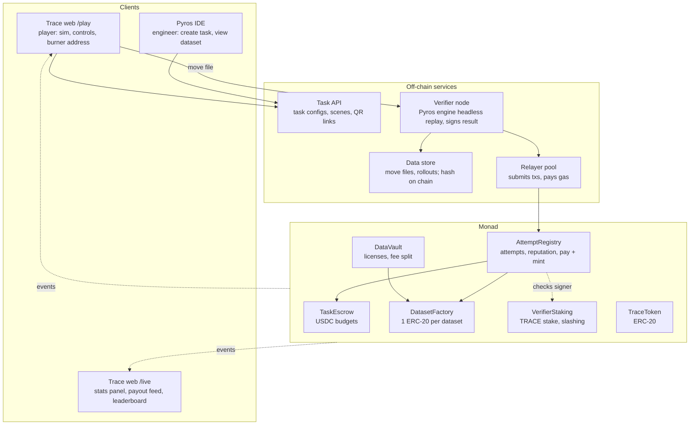
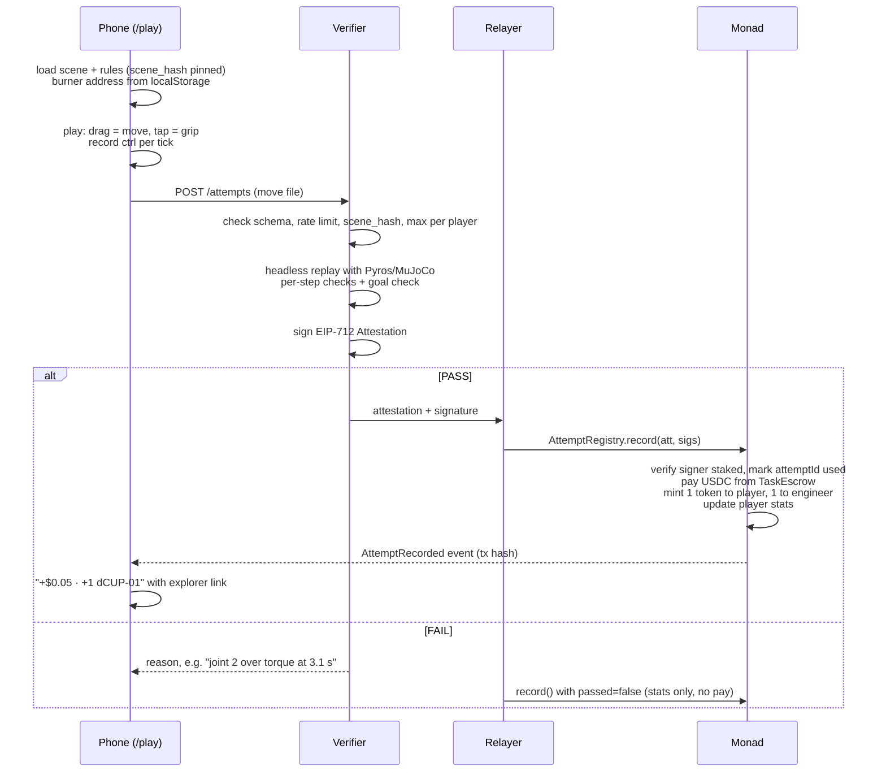

# Trace architecture

Trace is a tokenized data economy on Monad. The first market is robot demonstrations. A player controls a simulated arm in the browser. [Pyros](https://github.com/RudranshG07/pyros) replays the player's inputs on a server and checks the physics. Monad records each verified attempt, pays the player in USDC and mints dataset tokens in a single transaction.

This document is the build spec for the hackathon (4 Nov 2026) and the base for what comes after. Facts marked **(verify)** are not confirmed yet. Check them on the day and record the answers in `docs/resolved.md`.

## Principles

1. **The server's replay decides.** The browser sends inputs, never a result. A hacked client gains nothing.
2. **Physics is the reviewer.** A pass is computed from torques, joint limits, contacts and goal position. No voting and no manual review.
3. **One verified attempt is one payable unit.** One attempt leads to one transaction: record, pay, mint.
4. **The chain stores proofs, not data.** Move files, video and scenes live off chain. Monad stores hashes, money, tokens and reputation.
5. **Per-player and per-attempt storage.** Avoid global counters so that different players' payouts can run in parallel.
6. **Players never touch gas or wallets.** They get a burner address on first load, and a relayer pays all gas.

## System



### Where each piece runs

| Piece | Runs on | Today | Later |
|---|---|---|---|
| Pyros IDE (task form) | Engineer's laptop | One pre-made task created by a script. The IDE form is optional. | "Trace task" panel in the Pyros IDE. |
| Verifier | Always-on server, headless MuJoCo | Laptop plus a cloudflared or ngrok tunnel. | Render, Fly.io, Railway or a VPS. Later several independent staked nodes. |
| Relayer | Same process as the verifier | A pool of N hot keys. | Separate service, which any verifier can use. |
| Web (`/play`, `/live`) | Static hosting | Vercel or GitHub Pages. The sim runs in each player's browser, so it scales with players. | Same. |
| Contracts | Monad | Monad testnet with test USDC. | Mainnet after legal review. |
| Data store | Verifier disk | Local directory, served by the verifier. | IPFS or object storage. The hash stays on chain. |

## Core flows

### 1. Create a task

1. The engineer chooses the robot (MJCF or URDF), the scene, the goal zone, the rules, the pay per attempt and the budget.
2. Pyros fills torque and joint limits from the robot description and its actuator datasheets.
3. `TaskEscrow.createTask()` pulls the USDC budget and stores `sceneHash`, `rulesHash`, the pay per attempt, the per-player cap and the deadline. It calls `DatasetFactory` to deploy that task's dataset token.
4. The Task API publishes `/task/<taskId>` and a QR code.

For the demo, a deploy script creates one task, `cup-to-box`.

### 2. Play and verify



The verifier returns the result to the phone over HTTP right away, without waiting for the chain. The phone then listens for the `AttemptRecorded` event (or polls `GET /attempts/:id`) and shows the payout when it lands. This is how the phone measures "tap to paid" time.

### 3. License and earn

1. A buyer calls `DataVault.license(dataset)` and pays the dataset's license price in USDC.
2. The vault sends the USDC to the dataset token and calls `distribute(amount)`, which raises a per-share accumulator. This costs O(1) gas no matter how many holders there are.
3. Each holder calls `claim()` whenever they like. Their share is `balance × accumulator`, with corrections applied on mint and transfer (the standard "dividend-paying token" pattern), so tokens stay freely transferable and tradable.
4. The data server checks `DataVault.isLicensed(dataset, buyer)` and serves the move files and rollouts behind a signed URL.

**Demo finale:** a "robotics lab" wallet licenses `dCUP-01` for $5, and one transaction splits it across everyone in the room.

### 4. Disputes (roadmap)

Scenes, rules and move files are public, and the replay is deterministic, so anyone can re-run an attempt. Within a dispute window, a challenger submits the move file. If a re-run gives a different result than the one a verifier signed, that verifier's TRACE stake is slashed and the challenger is rewarded. Today the owner holds the slash function, and the trust model below says so.

## Data contracts

Freeze these four interfaces first so that the three workstreams can build in parallel.

### Scene and rules

`scenes/cup_to_box/scene.xml` is a MuJoCo MJCF file, and the browser and verifier load the same bytes. `sceneHash = keccak256(file bytes)`.

`scenes/cup_to_box/rules.json` contains the rules, and `rulesHash = keccak256(file bytes)`:

```json
{
  "schema_version": "1.0",
  "task": "cup-to-box",
  "mujoco_version": "3.x.y",
  "timestep": 0.002,
  "control_hz": 50,
  "max_duration_s": 30,
  "goal": {
    "body": "cup",
    "zone_site": "box_goal",
    "hold_s": 0.5,
    "max_speed_mps": 0.05
  },
  "checks": {
    "torque": { "per_actuator_max_nm": [40, 40, 20, 10] },
    "joint_limits": true,
    "collisions": { "forbid": [["arm", "table"]], "allow_target": "cup" },
    "smoothness": { "max_ctrl_jump": 0.25 },
    "duplicate": { "min_l2_distance": 0.5 }
  },
  "enabled_today": ["goal", "torque"]
}
```

Pin `mujoco_version` (verify) to the same release in the WASM build and in the Python `mujoco` package.

### Move file (browser to verifier)

```json
{
  "schema_version": "1.0",
  "task_id": "0x…32 bytes",
  "player": "0x…20 bytes",
  "scene_hash": "0x…",
  "rules_hash": "0x…",
  "client": "web-0.1.0",
  "ctrl": [[0.100, -0.300, 0.000, 0.000], [0.102, -0.298, 0.000, 0.000]],
  "grip": [0, 0],
  "wall_ms": [0, 20]
}
```

- `ctrl[k]` is the actuator control vector applied at control tick `k`, which is held for `1 / (control_hz × timestep)` physics steps (10 steps at 50 Hz and 2 ms).
- **The replay depends on the tick index, not wall time.** `wall_ms` is used only for the human-timing check.
- The client **quantizes ctrl to 3 decimals before applying it to its own sim**, so the browser and the verifier receive identical inputs.
- Touch input becomes an end-effector target. The browser solves IK and turns that target into joint targets (`ctrl`). IK runs only in the browser, so it doesn't need to be deterministic. Only the resulting `ctrl` is replayed.
- `movesHash = keccak256(raw request body bytes)`. The verifier stores those exact bytes, which avoids any JSON canonicalization question.
- Size: 30 s × 50 Hz × 4 floats is about 30–40 KB of JSON.

### Verifier API

| Method | Path | Returns |
|---|---|---|
| `GET` | `/tasks/:taskId` | Scene URL, rules, pay, remaining budget and the player's remaining cap. |
| `POST` | `/attempts` | `{ attemptId, passed, score, reasons[], metrics{}, status: "submitted" }` |
| `GET` | `/attempts/:attemptId` | `{ passed, txHash, status: "pending" \| "confirmed" \| "failed", confirmMs }` |
| `GET` | `/stats` | Relayer-side confirmation times and queue depth for `/live`. |
| `GET` | `/data/:dataset/:attemptId` | The move file and rollout, served only to licensees (signed URL). |

Each failure reason names a joint or constraint and a time, so the player can act on it: `"joint 2 torque 52.3 Nm > 40 Nm at 3.12 s"`, `"cup left goal zone at 6.4 s"`.

### Attestation (EIP-712, verifier to chain)

```solidity
struct Attestation {
  bytes32 taskId;
  address player;
  bytes32 movesHash;
  bool    passed;
  uint16  score;      // 0–10000
  uint64  deadline;   // signature expiry
}
// domain: name "Trace", version "1", chainId, verifyingContract = AttemptRegistry
```

`attemptId = keccak256(abi.encode(taskId, player, movesHash))`. The contract records every `attemptId` it processes, so the same attestation can't be paid twice.

## Verification pipeline (Pyros)

The Pyros engine runs headless:

1. **Load** the scene for `taskId`, and check that `scene_hash` and `rules_hash` match the task.
2. **Pre-checks:** schema, length at most `max_duration_s`, the rate limit per address and IP, the per-player cap, and that `attemptId` hasn't been seen.
3. **Replay** each tick by setting `data.ctrl`, then running `mj_step` the required number of substeps. After each step, record and check:
   - **Torque:** `|actuator_force[i]| ≤ limit[i]`
   - **Joint limits:** `qpos` and `qvel` stay within the joint ranges
   - **Collisions:** forbidden geom-pair contacts in `data.contact`
4. **Goal:** the target body is inside the `zone_site` box for the last `hold_s` seconds, below `max_speed_mps`.
5. **Human-likeness (later):** the jumps in `ctrl`, the jitter in `wall_ms` (a script has perfectly even timing) and the spread of reaction times.
6. **Duplicate (later):** the distance from the attempt's downsampled `ctrl` trajectory to the earlier passes on this task.
7. **Score:** 10000 minus penalties for time, peak torque ratio and jerk. Store the score with the attempt. It is the dataset's quality weight.
8. **Rollout:** save `qpos`, `qvel`, `actuator_force` and the contacts per tick. This is the dataset row, together with the success label.

**Today, only two checks are enabled: goal and torque.** Make the goal zone a little generous so that tiny floating-point differences between WASM and native MuJoCo can't flip a pass into a fail.

**Playability decision:** model "tap to grip" as a MuJoCo **adhesion actuator** (or a weld equality toggled on contact), not a two-finger friction grasp. A friction grasp with touch controls is too hard for a crowd at a venue, and a demo where nobody passes earns nobody anything.

## Contracts (Foundry, Solidity)

These are interface sketches. The final code may merge contracts if time runs short, but the external behaviour should stay the same.

```solidity
// TaskEscrow
struct Task {
  address engineer;
  address dataset;          // set by DatasetFactory at creation
  uint128 payPerAttempt;    // USDC, 6 decimals
  uint128 remaining;        // budget left
  uint128 verifierFee;      // per paid attempt, can be 0 today
  uint32  maxPaidPerPlayer;
  uint64  deadline;
  bytes32 sceneHash;
  bytes32 rulesHash;
}
function createTask(bytes32 salt, TaskParams calldata p) external returns (bytes32 taskId);
//   taskId = keccak256(engineer, salt), not a counter
function payout(bytes32 taskId, address player, address verifier) external; // onlyRegistry
function refund(bytes32 taskId) external;                                   // engineer, after deadline
event TaskCreated(bytes32 indexed taskId, address indexed engineer, address dataset, uint256 budget, uint256 payPerAttempt);

// AttemptRegistry
struct PlayerStats { uint32 attempts; uint32 passes; uint64 lastAt; }
mapping(bytes32 => bool)                         public seen;        // attemptId
mapping(address => PlayerStats)                  public stats;       // reputation
mapping(bytes32 => mapping(address => uint32))   public paidCount;   // taskId → player → paid attempts
function record(Attestation calldata a, bytes[] calldata sigs) external; // permissionless: any relayer
//   requires: deadline OK, !seen, quorum of signers with VerifierStaking.isActive
//   if passed && paidCount < cap: escrow.payout + dataset.mint(player,1) + dataset.mint(engineer,1)
event AttemptRecorded(bytes32 indexed attemptId, bytes32 indexed taskId, address indexed player,
                      bool passed, uint16 score, bytes32 movesHash, uint256 paid);

// DatasetFactory → DatasetToken (ERC-20 + dividend accumulator)
function createDataset(bytes32 taskId, string name, string symbol) external returns (address); // onlyEscrow
// DatasetToken
function mint(address to, uint256 amount) external;   // onlyRegistry
function distribute(uint256 usdcAmount) external;     // onlyVault, O(1)
function claim() external;                            // holder pulls USDC
function claimable(address) external view returns (uint256);

// DataVault
function setLicensePrice(address dataset, uint256 price) external; // engineer
function license(address dataset) external;                        // pull USDC → token.distribute
function isLicensed(address dataset, address who) external view returns (bool);
event Licensed(address indexed dataset, address indexed buyer, uint256 amount);

// VerifierStaking + TraceToken
function stake(uint256 amount) external;
function unstake(uint256 amount) external;          // after a cooldown, roadmap
function isActive(address verifier) external view returns (bool); // stake >= minStake
function slash(address verifier, uint256 amount, address to) external; // onlyOwner today; challenge game later
```

**Token amounts:** 1 token to the player and 1 to the engineer per verified attempt, using 18 decimals and minting `1e18` each. Total supply is therefore 2 × the number of verified attempts. Engineers own half of every dataset they fund, and players together own the other half.

**Fees:** take the platform fee (e.g. 10%) when the task is created. The verifier fee comes out of the budget for each paid attempt. Both can be zero for the demo.

**Quorum:** `record()` takes a `bytes[]` of signatures and a per-task quorum, so moving from 1-of-1 today to 2-of-3 later needs no interface change.

## Parallel execution: what actually parallelizes

Monad executes transactions optimistically in parallel and re-executes any that conflict, so a conflict never affects correctness, only throughput. Each `record()` writes:

| Slot | Scope | Contention |
|---|---|---|
| `seen[attemptId]` | Per attempt | None |
| `stats[player]`, `paidCount[task][player]` | Per player | None across players |
| Player's dataset-token balance and dividend correction | Per player | None across players |
| `Task.remaining` | Per task | **Hot within one task** |
| Dataset token `totalSupply` | Per dataset | **Hot within one task** |
| USDC `balanceOf[TaskEscrow]` | Global to the escrow | **Hot across all tasks** |

To say this honestly in the pitch: payouts for different players don't touch each other's state, and the hot slots are a handful of per-task counters. To push further after the event:

- **Lane reservation:** on a player's first pass, reserve `cap × pay` from `remaining` into a per-player lane, and draw later payouts from the lane.
- **One escrow clone per task**, so tasks never share a USDC balance slot.

**Relayer nonces are the real bottleneck.** One EOA's transactions have to go in nonce order. Use a pool of N relayer keys (start with 5), assign attempts round-robin, track nonces locally and fund every key. Because `record()` is permissionless and checks only the verifier's signature, any key can relay.

## Monad specifics (all verify)

| Item | Value or note |
|---|---|
| Testnet chain ID | `10143` (verify) |
| RPC | `https://testnet-rpc.monad.xyz` (verify). Get a second RPC as a fallback. |
| Explorer | `https://testnet.monadexplorer.com` (verify), used for payout-feed links. |
| USDC | **Don't hardcode a guessed address.** If official test USDC with a faucet is confirmed, use it. Otherwise deploy `MockUSDC` (6 decimals) and label it "test USDC" on screen. |
| Gas accounting | Monad charges on the **gas limit**, not gas used (verify). Measure each function's gas once and set a tight explicit `gasLimit` per call. Don't rely on padded estimates. |
| Finality | Sub-second (verify the block time and finality on the day). The panel shows measured numbers only, never quoted ones. |

## Live stats panel (`/live`)

Everything is read from the chain or measured. Nothing is hardcoded.

| Metric | Source |
|---|---|
| Total transactions and transactions per second | `AttemptRecorded` and `Licensed` logs per block, over a sliding 10 s window. Show network-wide TPS from block transaction counts next to it. |
| Tap-to-paid time | The phone measures submit to `AttemptRecorded`. The verifier measures `sendRawTransaction` to receipt and reports it via `/stats`. Show the median and p95. |
| Gas spent | Sum of `gasUsed × price` from receipts. Also show the cost per paid attempt. |
| USDC paid and tokens minted | Sum of `paid` from `AttemptRecorded`, and the dataset token's `totalSupply`. |
| Payout feed | The latest `AttemptRecorded` events, each linking to the explorer. |
| Leaderboard | `stats[player].passes`. Show short addresses or a nickname kept in localStorage. |
| Dataset token price | The DEX pool's spot price, if a pool exists. |

Use viem `watchContractEvent` over WebSocket if the RPC supports it. Otherwise poll `getLogs` every block.

## Trust model

v1 is onchain settlement with **one staked verifier**.

| Step | Trusted party | Check today | Later |
|---|---|---|---|
| Attempt result | Verifier | Replays are deterministic, and the scene, rules and moves are public, so anyone can re-run them. The signer must be staked. | 2-of-3 independent staked verifiers. |
| Wrong result | Owner | The owner can slash. | A challenge window and automatic slashing on a mismatched re-run. |
| Payout | Contracts | The signature, `seen`, the per-player cap and the budget are all enforced on chain. | Same. |
| Sybil farming | Verifier | Rate limits per address and IP, plus the per-player cap on chain. | Player staking tiers and reputation-gated tasks. |
| Data access | Data server | Checks `isLicensed` on chain. | Encrypted blobs and key release on license. |

A verifier could withhold a valid pass, but it can't steal from the budget or pay itself. A player can't get paid without a signature over moves that really pass.

## Repository layout

```
contracts/
  src/        TaskEscrow.sol AttemptRegistry.sol DatasetFactory.sol DatasetToken.sol
              DataVault.sol TraceToken.sol VerifierStaking.sol MockUSDC.sol
  script/     Deploy.s.sol (deploys all, stakes the verifier, creates cup-to-box)
  test/       record() happy path, double-spend, cap, unstaked signer, license split
verifier/
  trace_verifier/  api.py (FastAPI)  replay.py (MuJoCo)  checks.py  sign.py (EIP-712)
                   relayer.py (key pool, nonces)  store.py
  tests/      replay of a recorded passing and failing move file
web/
  /play       three.js + MuJoCo WASM, touch controls, recorder, burner address, payout toast
  /live       stats panel
  /task/:id   QR landing, task info
scenes/cup_to_box/  scene.xml  rules.json  fixtures/{pass,fail_torque}.json
docs/resolved.md    answers to every (verify) item
```

## Build plan (today)

| Owner | Part | Done when |
|---|---|---|
| A | Contracts and deploy | `forge test` passes. Deployed to testnet, with the verifier staked and `cup-to-box` funded. |
| A | `/live` panel | It shows transactions, TPS, tap-to-paid, gas, USDC paid and tokens minted from real events. |
| B | `/play` game | A phone can open the QR link, move the arm, grip, record and POST a move file. |
| C | Verifier and relayer | The `pass.json` fixture yields PASS plus a confirmed `record()` tx, and `fail_torque.json` yields FAIL with a reason. |

| Time | Milestone |
|---|---|
| First 20 min | The whole team agrees on the scene file, move-file schema, verifier API and contract events. Commit `scenes/` and the fixtures. |
| 13:45–15:00 | Contracts on testnet. The arm runs in a browser. The verifier judges a recorded move file. |
| 15:00–16:00 | End to end: play → verify → record + pay + mint. The phone shows "+$0.05 · +1 dCUP-01". TRACE stake works. |
| 16:00–17:15 | `/live` panel, license finale, deploy and tunnel, test with 5 or more phones. DEX pool if time. |
| 17:15–18:00 | Record a backup demo video, fund the relayer keys and the payout budget, rehearse the pitch. |

**Cut first if behind:** the duplicate check, levels, the human-timing check, the dataset export UI and the DEX pool. Put them on the roadmap slide.

**Fallback if MuJoCo WASM won't load within the first hour:** use a planar 3-link arm. The browser shows a kinematic three.js preview and the server still runs full MuJoCo physics to decide. The move-file format and the verifier stay the same.

## Risks

| Risk | Mitigation |
|---|---|
| WASM and native replay disagree | Pin the same MuJoCo version, quantize ctrl, use a generous goal zone, and add a CI test that replays the fixtures in both. |
| No one at the venue can pass the task | Adhesion grip, a large goal zone, and a 30-second practice mode with no payout. |
| Relayer runs out of gas or nonces jam | Use a key pool, a funded-balance alarm on `/live`, and a nonce reset on error. |
| Tunnel or laptop dies | Record a backup video. Keep the deploy script ready for a cloud VM. |
| Venue Wi-Fi | Move files are small. The sim runs on the phone, so only one POST goes over the network per attempt. |
| Rules on building from existing projects | Confirm with the organisers, and disclose in the pitch that Pyros existed before the event. |

## After the hackathon

- Run several independent verifier nodes with a 2-of-3 quorum, challenge-and-slash disputes, and TRACE staking for anyone who runs the Pyros engine.
- Add an x402 data API so engineers and AI agents can fund tasks and license datasets over HTTP.
- Add more task types (pick-and-place, assembly, navigation), with Pyros robot generators producing arms, mobile bases, hands and drones.
- **Crowd annotation of sensor data** (the earlier Trace design): RGB-D boxes, segmentation and 6-DoF pose on Pyros-rendered frames. Sim ground truth gives every task a known answer, so gold checks need no human reviewer.
- Export datasets to standard robot-learning formats.
- Teleoperate real robots on a bench, with sim tasks kept in every campaign as quality checks.
- Cash-out to local currency.
