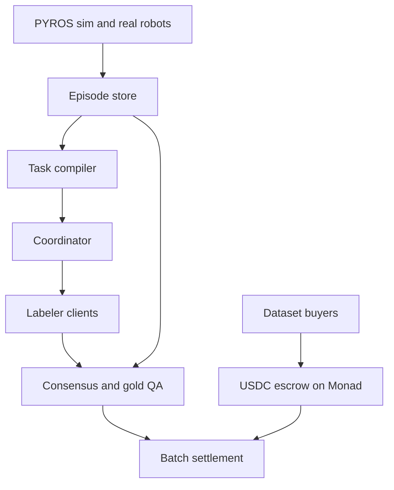

# Architecture

Decentralized labeling for physical AI. Contributors annotate robotics and sensor episodes and earn USDC. [PYROS](https://github.com/RudranshG07/pyros) produces the episodes and the gold labels. Monad holds escrow and settles batches.

Frames, point clouds, and label files stay in object storage. The chain stores content hashes, campaign escrow, settlement proofs, and reputation.

## Roles

| Role | Does |
|---|---|
| Buyer | Funds a campaign in USDC and receives an accepted dataset with provenance. |
| Labeler | Claims a clip, submits a label, and claims USDC after the batch settles. |
| Coordinator | Assigns work, leases tasks, and collects signed receipts. Off chain. |
| PYROS worker | Renders simulated episodes and, later, ingests real robot logs. |
| Contracts | Hold USDC, check proofs, pay labelers, record reputation. |

A labeler is a Monad address. A session key signs receipts so the wallet does not prompt on every frame.

## Principles

1. Ship the quality loop before mainnet. A wallet does not tell you whether a box is right.
2. One payable unit is one task, not one pixel and not one whole dataset.
3. Quality is computed. Box agreement is IoU. Pose error and timestamp skew are measured the same way PYROS measures a sim run.
4. Sim ground truth stays in the mix after real robots arrive, so a new address can be scored before it touches customer data.
5. Raw sensor data is private. A claim reveals one clip through a short-lived signed URL.

## System



Accent in the companion canvas marks the same two on-chain steps: escrow and batch settlement. Everything else is an ordinary service.

### Episode store

Content-addressed objects in a private bucket.

An episode manifest lists the sensors, timestamps, content hashes, and the robot description. A manifest is the unit the task compiler reads. The bytes never go into a transaction.

### Task compiler

Cuts a manifest into tasks. Each task names the sensor output, the time range, the label schema, the payout, and whether a gold answer exists.

Version every task and label with `schema_version`, using the same stability rule as `pyros/docs/schemas`: new fields may appear in a minor version, and a removed or redefined field is a major bump.

### Coordinator

The off-chain API.

- Creates campaigns from a buyer spec and a set of manifests.
- Leases a task for 10 minutes so two labelers do not take the same frame.
- Issues a signed URL for that clip only.
- Accepts an EIP-712 receipt: `taskId`, `labelHash`, payout, nonce.
- Holds the campaign budget while receipts are in flight, then releases the hold when QA accepts or rejects the batch.

The PYROS model gateway is the pattern for this service: verify a credential, hold budget, refuse when the hold would overdraw, and never log the payload. Labeler login is a wallet signature, not the gateway’s WorkOS session. Model spend and OpenRouter stay out.

### Quality

Two paths into the same settlement batch.

- **Open tasks.** Three independent labels. For boxes, acceptance is pairwise IoU above a threshold set per campaign. Discrete classes use majority.
- **Gold tasks.** About one task in ten is a PYROS frame whose object pose is known. Failing gold drops reputation and withholds that labeler’s share of the batch.

Contact, force, and 6-DoF pose wait for an expert tier. Crowd consensus is a weak signal on those.

### Monad

Three contracts. None of them store an image or a label file.

| Contract | Holds |
|---|---|
| `CampaignEscrow` | USDC, the task merkle root, the payout per accepted task, and a deadline. Unclaimed funds return to the buyer after the deadline. |
| `BatchSettlement` | A receipt root. Checks quorum or a gold pass, then releases USDC to the labeler against a merkle proof. |
| `Reputation` | Accepted labels and gold failures for an address. Updated in the settlement transaction. |

Confirm the live USDC token address on Monad at implementation time. Do not hardcode a guessed address.

Paying contributors is money transmission in many jurisdictions. Get counsel before a public payout.

## Trust model

v1 is decentralised settlement with a trusted coordinator.

| Step | Trusted party | Check |
|---|---|---|
| Task assignment and leases | Coordinator | Labeler signs every receipt with a session key. |
| Quality decision | Coordinator | Gold tasks have known answers, and anyone can recompute IoU from label hashes. |
| Receipt root | Coordinator | `BatchSettlement` enforces quorum or a gold pass. |
| Payout | Contracts | Merkle proof against the posted root. |

The coordinator chooses who is in the receipt root, so a labeler cannot yet dispute an omission. Planned for after the pilot: a challenge window on `BatchSettlement` where a labeler submits their signed receipt and the batch reverts if the root omits it.

Lease state and held budget live in the coordinator database, not in process memory. A restart must not release a hold or double-lease a task.

## Economics

Micropayments are batched. A labeler earns per accepted task and receives USDC when the batch settles and they claim.

| Quantity | Definition |
|---|---|
| Payout per task | Set per campaign in `CampaignEscrow`. |
| Cost per accepted label | Payout × labels per task (3 for open tasks) + gold overhead + gas share. |
| Gas share | Gas for one settlement transaction ÷ accepted tasks in the batch. |
| Claim cost | Gas for one merkle claim, paid per labeler per claim. |
| Minimum claim | The balance at which claim cost is a small fraction of the payout. |

Payout per task, gas per batch, and claim cost on Monad are not measured yet. Step 6 records them. Until then, do not state a cost per label.

A labeler claims once their balance passes the minimum claim, not per task. That is what makes small payouts practical for contributors anywhere.

## Label schema v1

The first task is an RGB-D frame with a 2D box, a class, and a graspable flag. Gazebo already publishes image, depth, and points, and a scripted scene knows the object pose, so every gold task has a checkable answer.

```json
{
  "schema_version": "1.0",
  "task_id": "0x…",
  "frame_hash": "0x…",
  "sensor": "rgbd_camera",
  "boxes": [
    {
      "class": "mug",
      "graspable": true,
      "x": 0.42,
      "y": 0.31,
      "w": 0.12,
      "h": 0.18
    }
  ]
}
```

Box coordinates are fractions of the frame, origin at the top left.

Later schemas, each still gold-checkable from PYROS:

| Schema | Gold source in PYROS |
|---|---|
| 2D box + class + graspable | Scripted object pose, projected with the camera model |
| Segmentation | `segmentation_camera` output |
| 6-DoF pose | Simulator object pose, scored with ADD-S |
| Contact or force event | `contact` and `force_torque` sensors |
| Trajectory success | `SimResult` in `pyros/src/pyros/sim/metrics.py` |

## What comes from PYROS

PYROS is a local robotics engineering copilot (Apache-2.0). It has no marketplace, no wallet, and no annotation format. The repository used for this mapping is `Desktop/Projects/PYROS`.

| Piece | Use |
|---|---|
| `pyros/src/pyros/sim/gz_sensors.py` | Task vocabulary. Camera, depth, RGB-D, `gpu_lidar`, IMU, force/torque, contact, and navsat, each with ROS message types and realistic rates. A task names one of these outputs. |
| Gazebo and MuJoCo backends, robot generators | Episode factory across arms, mobile bases, hands, humanoids, and drones. Simulator poses and contacts are the gold labels. |
| `pyros/src/pyros/robotics/perception.py` | `select_sensor_suite` and `size_vision_system` decide which sensors a buyer task needs, and therefore which schema applies. |
| `pyros/src/pyros/live/bridge.py`, `pyros/src/pyros/runtime/log_reader.py` | Ingest pattern for a real robot: joint states, tf, topic samples, and ROS logs become an episode manifest. |
| `pyros/docs/schemas` | Versioned JSON for episodes, tasks, and labels. |
| `pyros/src/pyros/sim/metrics.py`, `pyros/src/pyros/tuning/scoring.py` | The rule that a score is computed. Do not reuse `SimResult` fields as label scores. |

Out of v1: the VS Code IDE, the language server, actuator sizing, and controller selection. Those fit later, when a buyer designs a robot in PYROS and then orders a dataset for that embodiment.

## Build sequence

Each step is done when the check in the last column passes. Chain work starts at step 5.

| Step | Work | Done when |
|---|---|---|
| 1 | Label schema v1 | A label file validates against the JSON above. |
| 2 | PYROS episode exporter | A scenario writes RGB-D frames plus object pose, and a scorer compares a hand label to that pose. |
| 3 | Labeler web client | A person draws a box, submits the file, and sees the gold score. No wallet. |
| 4 | Coordinator | Campaigns, 10-minute leases, signed clip URLs, EIP-712 receipts. |
| 5 | Monad testnet escrow | A buyer funds USDC. A batch root pays labelers who pass QA. Unclaimed funds return after the deadline. |
| 6 | Closed pilot | One buyer, a small labeler set, synthetic episodes only. Record acceptance rate and USDC per accepted label. |
| 7 | Real robots | MCAP or rosbag2 enters through the bridge pattern. Sim gold tasks remain in every campaign. |

## Design choices still open

These are starting points, not measured results.

- Gold-task share: 1 in 10.
- Box agreement: campaign-level IoU threshold, initial target 0.7.
- Lease length: 10 minutes.
- Batch interval: minutes, not per frame. One settlement transaction covers the batch.
- Expert review for contact, force, and 6-DoF once the USDC loop is proven on boxes.
