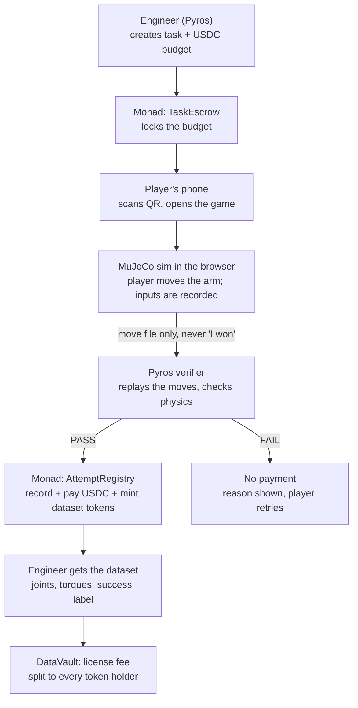

# Trace

**A tokenized data economy on Monad.** Every human contribution becomes a verified onchain asset, paid in real time.

The first market is robot training data. Anyone with a phone controls a robot arm in a browser simulation. Each attempt that passes a physics check pays USDC instantly on Monad and mints a token for the dataset the player helped create. When the dataset is licensed, the fee is split among everyone who holds that token.

> Monad Blitz Mumbai (Devcon Edition), 4 Nov 2026 · Verified by [Pyros](https://github.com/RudranshG07/pyros) · Settled on Monad

---

## The problem

- **Robots learn by copying humans.** To learn one task, such as putting a cup in a box, a robot needs thousands of human demonstrations, each done a little differently.
- **Collecting them is slow and expensive.** Companies pay operators in labs (Tesla pays around $48/hour for Optimus teleoperation). The work happens in a few places with a few people.
- **Crowdsourcing has two blockers.** You can't trust strangers' work, and you can't pay thousands of people a few cents each through banks or PayPal.

## The solution

Trace turns robot training into a game anyone can play from a phone.

| | |
|---|---|
| **Pyros checks it** | The Pyros physics engine replays every attempt on the server. It checks whether the task succeeded, whether a motor was overloaded and whether the arm crashed. Nobody reviews attempts by hand, and a hacked client can't fake a pass. |
| **Monad pays it** | Every valid attempt is paid in USDC on Monad in under a second. Fees are close to zero, so a $0.05 payment to anyone in the world works. |
| **Players own it** | Each valid attempt mints dataset tokens: 1 to the player and 1 to the engineer who funded the task. Every license fee is split pro-rata among the token holders. |

## Who uses it

- **The robot engineer (buyer)** designs and simulates a robot in Pyros, publishes a task with a USDC budget, and pays for each valid demonstration.
- **The player (contributor)** opens a link or scans a QR code and plays. They need no app, no wallet setup and no crypto knowledge. They earn USDC for every attempt that passes the physics check.
- **Dataset licensees** (AI labs, other Pyros users, AI agents) pay to license a dataset, and the fee goes to the token holders.

## How it works



## Why Monad

- **One tap is one transaction with three state changes:** record the attempt, pay USDC and mint dataset tokens. Hundreds of players produce thousands of transactions per minute, and that load needs near-zero fees and sub-second finality.
- **The contracts are built for parallel execution.** They use per-player and per-attempt storage instead of global counters, so different players' payouts don't contend for the same slots.
- **Players never pay gas.** A relayer submits every transaction, so players never need MON.
- **The chain is the star of the demo.** A live panel shows transactions per second, confirmation time, gas spent, USDC paid and tokens minted, all read from Monad events.

## Onchain assets

| Asset | Standard | Role |
|---|---|---|
| USDC | ERC-20 | Task budgets in escrow, per-attempt payouts and license fees. |
| Dataset token (e.g. `dCUP-01`) | ERC-20, one per dataset | 1 minted to the player and 1 to the engineer per verified attempt. Earns a pro-rata share of license fees. Tradable. |
| TRACE | ERC-20 | Staked by verifier nodes. A node that signs a wrong result is slashed. |
| Reputation | Onchain stats, not a token | Attempts, passes and level per player. Not transferable, so it can't be bought. |

## Today vs roadmap

| Build today | Roadmap |
|---|---|
| TaskEscrow, AttemptRegistry with reputation, DatasetFactory and dataset tokens, DataVault license and pro-rata claim, TRACE token with one staked verifier, browser arm game with QR, Pyros verifier (goal + torque checks), live Monad stats panel, DEX pool (if time) | 3 verifier nodes with 2-of-3 quorum, challenge-and-slash disputes, x402 data API for AI agents, player staking tiers, more task types, crowd annotation of Pyros sensor data, export to standard robot-learning formats, real-robot teleoperation |

## Repository layout

```
contracts/   Foundry: TaskEscrow, AttemptRegistry, DatasetFactory, DatasetToken, DataVault, TraceToken, VerifierStaking
verifier/    Python: FastAPI + MuJoCo replay + web3 relayer
web/         Static site: /play (game), /live (stats panel), /task/:id (QR landing)
scenes/      Shared MuJoCo scene files: one source of truth for browser and verifier
docs/        Notes resolved during the build
```

See [ARCHITECTURE.md](./ARCHITECTURE.md) for the full design: data formats, contract interfaces, the verification pipeline, the trust model and the build plan.

## Disclosure

Pyros, the robotics engineering copilot and physics engine, existed before this event. The following were built today: the Trace network, the smart contracts, the game website, the verifier integration and the live stats panel.

Tokens that share revenue can count as securities in some jurisdictions, and paying contributors can count as money transmission. This demo runs on Monad testnet with test USDC. Get legal advice before a mainnet launch.

---

## Monad Blitz submission process

1. Visit the `monad-blitz-devcon-mumbai` repo ([link](https://github.com/monad-developers/monad-blitz-devcon-mumbai)) and fork it.


2. Give it your project name and a one-line description, make sure you are forking the `main` branch, and click `Create Fork`.


3. In your fork you can change anything: add your project's code, create branches and edit `README.md`.

4. For next steps, head to the [Blitz Portal](https://blitz.devnads.com).
