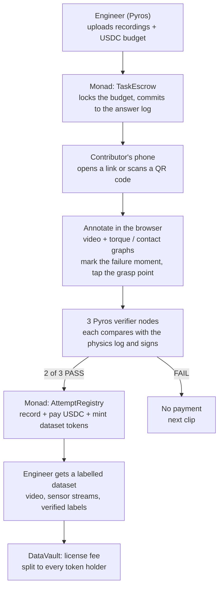
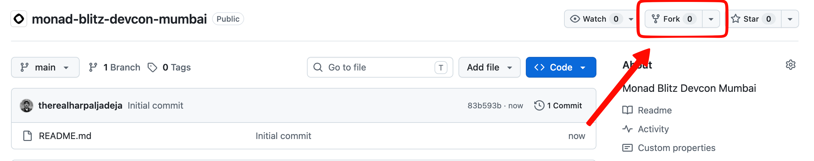

# Trace

**A tokenized data economy on Monad.** Every human contribution becomes a verified onchain asset, paid in real time.

The first market is a decentralised data-labelling network for physical AI. Anyone with a phone annotates robot recordings, meaning video together with sensor streams such as joint torque and contact force. They can also record robot demonstrations. Every contribution is checked against physics by three independent [Pyros](https://github.com/RudranshG07/pyros) verifier nodes. Each valid annotation pays USDC instantly on Monad and mints a token for the dataset the contributor helped create. When the dataset is licensed, the fee is split among everyone who holds that token.

> Monad Blitz Mumbai (Devcon Edition), 4 Nov 2026 · Verified by Pyros · Settled on Monad

---

## The problem

- **Robots learn from labelled data.** Every robot recording (camera video plus sensor streams such as joint torque and contact force) has to be annotated: when did the grasp fail, where should the robot have grabbed, what's in the scene. Robots also need thousands of human demonstrations per task.
- **Labelling is slow and expensive.** It's done in labs by a few people in a few places. Tesla pays operators around $48/hour for Optimus data.
- **Crowdsourcing has two blockers.** You can't trust strangers' labels, and you can't pay thousands of people a few cents each through banks or PayPal.

## The solution

Contributors annotate robot recordings from their phones. The work is interactive, not a multiple-choice quiz, and contributors earn for every annotation that physics confirms.

| | |
|---|---|
| **Pyros checks it** | The Pyros engine keeps an exact physics log of every recording: when contact happened, when torque spiked and where the object was. Annotations are checked against that log automatically. There is no voting or manual review, and random clicking doesn't pay. |
| **Monad pays it** | Every valid annotation is paid in USDC on Monad in under a second. Fees are close to zero, so a $0.05 payment to anyone in the world works. |
| **Contributors own it** | Each valid contribution mints dataset tokens: 1 to the contributor and 1 to the engineer who funded the task. Every license fee is split pro-rata among the token holders. |

### Two ways to contribute

| Annotate (core) | Demonstrate (bonus) |
|---|---|
| Label existing robot recordings using their sensor data: failure moments, grasp points, contact events and objects. Each clip takes 10–20 seconds, and every label is verified against the Pyros physics log. | Control a robot arm in the browser sim to show it how to do a task. Pyros replays the attempt and checks it. Every demonstration, failed ones especially, also becomes a new recording for others to annotate. |

## Who uses it

- **The robot engineer (buyer)** has thousands of sim and real-robot recordings that need annotating, and needs demonstrations to train on. They pay per valid annotation or demonstration.
- **The contributor** is anyone with a phone, such as a student in Chennai or a gamer in Lagos. They need no app, no wallet setup and no crypto knowledge.
- **Dataset licensees** (AI labs, other Pyros users, AI agents) pay to license a dataset, and the fee goes to the token holders.

The engineer sets the task and rules once. Contributors just mark what they see, and Pyros catches mistakes automatically.

## How it works



## Why Monad

- **One verified annotation is one transaction with three state changes:** record it, pay USDC and mint dataset tokens. A room of contributors at 10–20 seconds per clip produces thousands of transactions per minute, which needs near-zero fees and sub-second finality.
- **The contracts are built for parallel execution.** They use per-contributor and per-contribution storage instead of global counters, so different contributors' payouts don't contend for the same slots.
- **Contributors never pay gas.** A relayer submits every transaction, so contributors never need MON.
- **The chain is the star of the demo.** A live panel shows transactions per second, confirmation time, gas spent, USDC paid and tokens minted, all read from Monad events.

## Onchain assets

| Asset | Standard | Role |
|---|---|---|
| USDC | ERC-20 | Task budgets in escrow, per-contribution payouts and license fees. |
| Dataset token (e.g. `dCUP-01`) | ERC-20, one per dataset | 1 minted to the contributor and 1 to the engineer per verified contribution. Earns a pro-rata share of license fees. Tradable. |
| TRACE (called ARENA in the idea doc) | ERC-20 | Staked by each verifier node. A node that signs a wrong result is slashed. |
| Reputation | Onchain stats, not a token | Contributions, passes and level per contributor. Not transferable, so it can't be bought. |

## Today vs roadmap

| Build today | Roadmap |
|---|---|
| TaskEscrow, AttemptRegistry with reputation, DatasetFactory and dataset tokens, DataVault license and pro-rata claim, TRACE token with **3 staked verifier nodes and 2-of-3 signatures**, annotation UI on 20–30 Pyros sim clips, live Monad stats panel, demonstration mode and DEX pool (if time) | Verifier nodes run by independent operators, challenge-and-slash disputes, x402 data API for AI agents, contributor staking tiers, real-robot ROS 2 recordings, more annotation types and data beyond robotics |

## Repository layout

```
contracts/   Foundry: TaskEscrow, AttemptRegistry, DatasetFactory, DatasetToken, DataVault, TraceToken, VerifierStaking
verifier/    Python: coordinator (task API + relayer) and verifier node (run as 3 processes)
exporter/    Python: Pyros/MuJoCo clip exporter (video, sensor streams, physics log)
web/         Static site: /t/:task (annotate), /live (stats panel), /demo (bonus sim)
clips/       Exported clip bundles for the demo task
docs/        Notes resolved during the build
```

See [ARCHITECTURE.md](./ARCHITECTURE.md) for the full design: data formats, contract interfaces, the verification pipeline, the trust model and the build plan.

## Disclosure

Pyros, the robotics engineering copilot and physics engine, existed before this event. The following were built today: the Trace network, the smart contracts, the annotation website, the verifier network, the clip exporter and the live stats panel.

Tokens that share revenue can count as securities in some jurisdictions, and paying contributors can count as money transmission. This demo runs on Monad testnet with test USDC. Get legal advice before a mainnet launch.

---

## Monad Blitz submission process

1. Visit the `monad-blitz-devcon-mumbai` repo ([link](https://github.com/monad-developers/monad-blitz-devcon-mumbai)) and fork it.



2. Give it your project name and a one-line description, make sure you are forking the `main` branch, and click `Create Fork`.


3. In your fork you can change anything: add your project's code, create branches and edit `README.md`.

4. For next steps, head to the [Blitz Portal](https://blitz.devnads.com).
